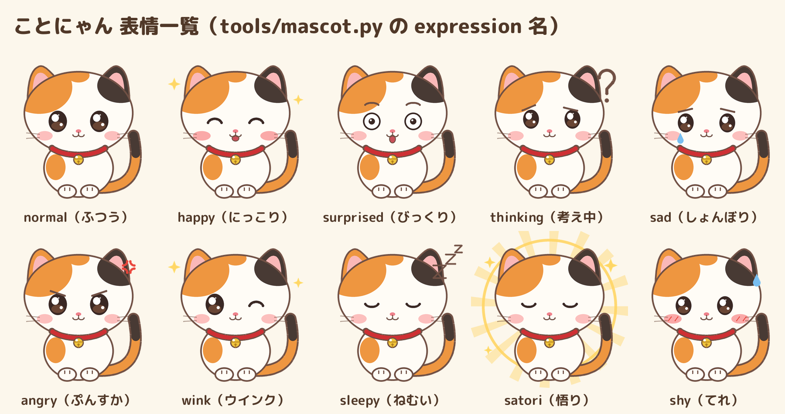

# ことにゃんのありがた言葉 — YouTube 制作キット

仏教・聖書・故事成語などの「古いことば」を伝える動画を量産するための仕組みです。

| 形式 | フォルダ | 内容 |
|---|---|---|
| **ショートアニメ（メイン）** | [`anime/`](anime/README.md) | セリフなし・縦型の物語アニメ。制作仕様（spec.md）→ 自動で絵・カメラ・光・字幕・音楽 |
| 解説動画 | `episodes/` `tools/render.py` | マスコットが字幕で解説する横動画・ショート（下記） |
| LINEスタンプ・グッズ | `stamps/` `tools/stamps.py` | マスコット「ことにゃん」のスタンプ・高解像度画像 |

チャンネル方針・動画の型・ネタ帳は [`構成メモ.md`](構成メモ.md) にあります。

---

## 解説動画キット

マスコット **ことにゃん** が字幕で「ことば」を解説する動画を、**台本（YAML）を1枚書くだけで** 作れます。



## できること

| コマンド | 出力 |
|---|---|
| `python tools/render.py episodes/001_shogyomujo.yaml` | 横動画 `video.mp4`・サムネ・字幕 `.srt`・概要欄テキスト |
| `… --format shorts` / `--format both` | ショート動画 `shorts.mp4`（縦 1080x1920） |
| `… --preview` | シーンごとの静止画だけ（数秒で確認できる） |
| `python tools/stamps.py --sheet` | LINEスタンプ一式＋申請用 zip |
| `python tools/stamps.py --hires 3000` | グッズ用 3000px キャラ画像（全表情） |
| `python tools/export_character.py` | キャラ画像を1枚ずつ（白背景・全表情＋ことば帖/ちょうちん/ほたるにゃん）。`--transparent` で透過、`--size` で大きさ |
| `python tools/make_banner.py` | YouTube のバナー（2560x1440）とアイコン（800x800）。`--title` で文字を変更 |
| `python tools/new_episode.py <slug>` | 新しい台本ファイルを番号つきで作成 |

出力はすべて `output/` に入ります（git 管理外）。

## はじめての準備（1回だけ）

```bash
cd youtube
pip install -r requirements.txt     # Pillow, PyYAML, numpy
./tools/setup_fonts.sh              # 丸ゴシック体・明朝体（商用OK）をダウンロード
# ffmpeg も必要: mac → brew install ffmpeg / Windows → winget install ffmpeg
```

### 声をつける（任意・おすすめ）

1. [VOICEVOX](https://voicevox.hiroshiba.jp/) をインストールして起動（起動しておくだけでOK）
2. `config.yaml` の `voice.speakers` で声を選ぶ（話者IDは VOICEVOX で確認）
3. 使ったキャラの **クレジットを `voice.credit` に書く**（概要欄に自動で入ります。VOICEVOX の規約で必須）

VOICEVOX が起動していないときは自動で「字幕のみ・無音」の動画になります。
BGM を入れたいときは `assets/bgm/` に音源を置き、`config.yaml` の `bgm.file` にファイル名を書きます（著作権フリー素材を使用）。

## 1本作る流れ

```
① ネタを決める     … 構成メモ.md のネタ帳から選ぶ
② 台本を書く        … python tools/new_episode.py <slug> → YAML を埋める
                      （Claude Code なら「〇〇の回を作って」で台本作成〜レンダリングまで自動）
③ プレビュー確認    … python tools/render.py episodes/xxx.yaml --preview
④ 書き出し          … python tools/render.py episodes/xxx.yaml --format both
⑤ アップロード      … video.mp4 / thumbnail.png / metadata.txt の内容 / subtitles.srt
⑥ 記録              … 構成メモ.md のネタ帳を「済」に、再生数をメモ
```

### 台本の書き方

`episodes/_template.yaml` にすべての項目の説明があります。実例は `episodes/001〜003`。

```yaml
scenes:
  - type: talk                     # title / talk / quote / ending
    heading: "どんな意味？"          # ボード上部の見出し（＝チャプター名）
    board: "すべてのものは\n移り変わる"  # ボードに大きく出す文字
    lines:
      - { expression: thinking, text: "字幕の文", say: "読み上げ用のふりがな（必要なときだけ）" }
```

## フォルダ構成

```
youtube/
├── 構成メモ.md            チャンネル方針・動画の型・ネタ帳 ← まずここを見る
├── anime/                 ショートアニメ制作キット（anime/README.md）
├── config.yaml            チャンネル名・カテゴリ色・声・フォント・BGM
├── character/PROFILE.md   キャラ設定（口調・色・NG）← 台本を書く前に読む
├── episodes/              台本（1本 = 1ファイル）
├── stamps/stamps.yaml     LINEスタンプの文言と表情
├── tools/
│   ├── mascot.py          キャラ描画（表情はここで増やす）
│   ├── render.py          台本 → 動画・サムネ・字幕・概要欄
│   ├── stamps.py          LINEスタンプ・グッズ用画像
│   └── ...
└── assets/                フォント・BGM（自分で置く素材）
```

## カスタマイズ

- **カテゴリを増やす**（例: 神道、ギリシャ神話）… `config.yaml` の `categories` に追加
- **キャラの色を変える** … `tools/mascot.py` の `PALETTE`
- **画面レイアウト** … `tools/render.py` の `LAYOUTS`
- **画像を出したい** … シーンに `image: assets/xxx.png` を書くとボードに表示

## 公開前チェックリスト

- [ ] 出典（経典・聖書の章節・書名）が正しいか、`references` に書いたか
- [ ] 宗教をからかう表現になっていないか（`character/PROFILE.md` のルール）
- [ ] VOICEVOX のクレジットが概要欄にあるか
- [ ] BGM・画像の利用規約を確認したか
- [ ] YouTube の「改変・合成コンテンツ」「子ども向け」設定を確認したか

## LINEスタンプの申請

1. `python tools/stamps.py --sheet` → `output/line_stamps/line_stamps.zip`
2. [LINE Creators Market](https://creator.line.me/ja/) で新規スタンプを作成し、zip をアップロード
3. スタンプの文言は `stamps/stamps.yaml` で変更（個数は 8/16/24/32/40）

## ライセンスまわり

- キャラクター「ことにゃん」とこのツールの出力画像はあなたのオリジナル素材として使えます（グッズ化OK）
- フォント M PLUS Rounded 1c・しっぽり明朝 B1 は SIL Open Font License（商用利用・スタンプ利用OK）
