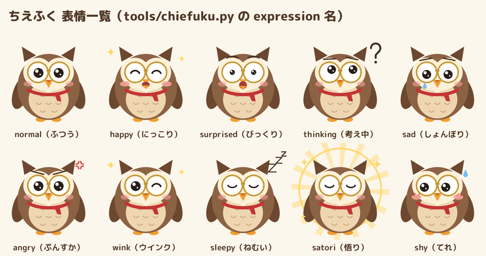

# ちえふく — キャラクター設定

| 項目 | 設定 |
|---|---|
| 名前 | **ちえふく**（知恵 ＋ ふくろう ＋ 福） |
| 種族 | フクロウ（「不苦労」「福籠」の縁起物。知恵の象徴としては東西共通） |
| 見た目のトレードマーク | 金の丸メガネ／朱色の首巻き／ハート形の顔 |
| 性格 | 物知りだけど偉ぶらない。びっくりしやすく、すぐ感動する |
| 一人称 | ぼく |
| 口調 | です・ます を使わない親しみ口調。「〜だよ」「〜なんだ」「〜だね」 |
| 決め台詞（冒頭） | 「こんにちは！古いことばを集めるフクロウ、ちえふくだよ！」 |
| 決め台詞（締め） | 「また次回も、古いことばを一緒に集めようね！」 |
| 好きなもの | 古い本、巻物、夜のお寺と教会の鐘の音 |
| 夢 | 世界中の古いことばを集めて「ことば帖」を完成させること |

## カラー（グッズ・印刷はこの値を使う）

| 部位 | RGB | HEX |
|---|---|---|
| 羽 | 140, 98, 68 | `#8C6244` |
| 翼・耳羽 | 108, 72, 48 | `#6C4830` |
| おなか | 238, 214, 176 | `#EED6B0` |
| 顔 | 252, 240, 216 | `#FCF0D8` |
| メガネ | 196, 150, 52 | `#C49634` |
| くちばし・足 | 240, 158, 52 | `#F09E34` |
| 首巻き | 196, 52, 52 | `#C43434` |

色を変えるときは `tools/chiefuku.py` の `PALETTE` を変えれば、動画・サムネ・スタンプすべてに反映されます。

## 台本を書くときのルール

- 宗教・信仰を**からかわない**。紹介はていねいに、出典（経典名・聖書の章節・古典の書名）を必ず添える
- 「諸説あります」なものは断定しない（「〜と言われているよ」）
- 教義の優劣を語らない。仏教・キリスト教・故事を同じ目線で「ことば」として紹介する
- 1行は字幕で40字くらいまで。長い説明は行を分ける

## 表情の使い分け

| expression | 使いどころ |
|---|---|
| `normal` | ふつうの説明 |
| `happy` | あいさつ・うれしい話 |
| `surprised` | 意外な事実・「でもね」の転換 |
| `thinking` | 問いかけ・誤解の紹介 |
| `sad` | 悲しい話・失敗談 |
| `angry` | 怒り・理不尽 |
| `wink` | ちょっとした豆知識・ツッコミ |
| `sleepy` | 夜・眠い話 |
| `satori` | まとめ・オチ（後光つき） |
| `shy` | 照れ・ほめられたとき |

表情を増やすときは `tools/chiefuku.py` の `EXPRESSIONS` に名前を足し、`draw()` に目・眉などの分岐を追加します。
